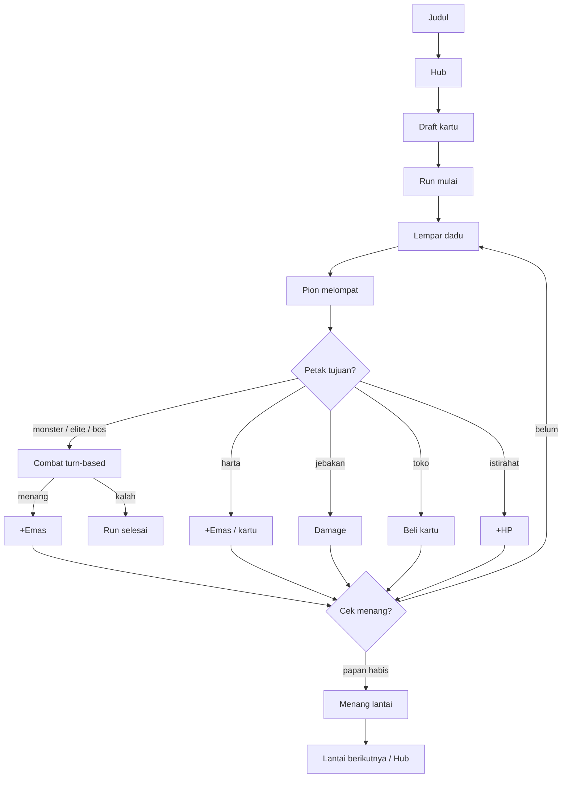

# Dice Delve

Board-roguelike 3D stylized yang berjalan langsung di browser: lempar dadu,
jelajahi papan prosedural, kumpulkan kartu, dan kalahkan bos. Papan 10x10
diacak ulang setiap run, lawan AI berkepribadian, sistem kartu relic,
hub meta-progresi, dan bisa dipasang sebagai PWA (offline).

Demo: https://fawwaz1st.github.io/dice-delve/

## Cara main

Aturan singkat:

1. Di hub, beli upgrade permanen dengan shard.
2. Pilih 1 kartu awal dari draft (3 pilihan).
3. Klik Lempar Dadu: pion melompat sesuai nilai dadu.
4. Petak monster memulai combat turn-based melawan AI.
5. Kalahkan bos untuk menembus papan dan naik lantai.
6. HP mencapai nol mengakhiri run; hasil run menjadi shard.

## Fitur

- Papan prosedural 10x10 dengan 34 petak — monster, elite, harta, jebakan,
  toko, istirahat, dan bos — seed harian (xorshift) sehingga papan bisa
  dibagikan dan diulang.
- Dadu 3D dengan animasi tween deterministik yang mendarat tepat pada
  nilai yang terpilih.
- Combat turn-based melawan AI berkepribadian: Agresif (serangan tinggi),
  Penjaga (HP/pertahanan tinggi), dan Licik (kadang menghindari).
- 10 kartu relic: Bara Api, Batu Karat, Semanggi, Bulu Angin, Mata Ketiga,
  Pijar, Gelombang (+2 damage), Magnet Emas (+25% emas), Benteng (-1 damage),
  dan Pusaka (heal saat bunuh).
- Draft kartu di awal run: pilih 1 dari 3.
- Hub meta-progresi: shard permanen untuk 4 upgrade (Vitalitas +10 HP,
  Dadu Tajam +1 damage, Keberuntungan +1 dadu, Serakah +15% emas), plus
  statistik (lantai terbaik, total run, bunuh, emas).
- Progresi lantai: papan baru tiap lantai, HP/emas/kartu dipertahankan.
- Juice premium: ledakan partikel (hit, koin, heal, motes), angka damage
  melayang, kamera follow + trauma shake + fokus combat, squash & stretch.
- Dekorasi low-poly: pohon, kristal berpendar, batu; pencahayaan key + rim
  + fill, fog, dan outline ink stylized pada pion/dadu/monster.
- Audio disintesis penuh (Web Audio): SFX lempar, lompat, tabrakan, koin,
  kartu, menang, kalah, dan musik adaptif (tenang/normal/tegang mengikuti
  combat). Tombol bisu di HUD.
- PWA: bisa dipasang ke layar utama dan dimainkan offline.
- WebGPURenderer (Three.js) dengan fallback WebGL2 otomatis.
- Loop fixed-timestep dengan interpolasi; deteksi tier perangkat dan
  pixel ratio clamp untuk 60fps di laptop menengah dan ponsel.
- Responsif: HUD adaptif, toast, log combat, layar judul/hub/akhir,
  dan dukungan reduced-motion.

## Menjalankan

Prasyarat: Node.js 20+ dan pnpm.

    pnpm install
    pnpm dev        # http://127.0.0.1:5173/dice-delve/
    pnpm build      # bundle ke dist/

Deployment ke GitHub Pages ditangani GitHub Actions (push ke main).

## Struktur proyek

    .
    ├── index.html              # Entri Vite
    ├── public/
    │   ├── manifest.webmanifest
    │   ├── sw.js               # Service worker offline-first
    │   └── icons/
    ├── docs/                   # Tangkapan layar untuk README
    ├── src/
    │   ├── main.ts             # Orkestrasi boot, layar, HUD, loop
    │   ├── core/
    │   │   ├── Renderer.ts     # WebGPURenderer + fallback WebGL2
    │   │   ├── Loop.ts         # Fixed timestep + interpolasi
    │   │   ├── Platform.ts     # Deteksi tier perangkat
    │   │   └── EventBus.ts
    │   ├── render/
    │   │   ├── Scene.ts        # Meja, cahaya, dekorasi, kamera
    │   │   └── Materials.ts    # Palet, material, outline ink
    │   ├── gameplay/
    │   │   ├── Board.ts        # Papan prosedural (DFS backtracking)
    │   │   ├── Dice.ts         # Dadu animasi tween
    │   │   ├── Piece.ts        # Pion dengan squash & stretch
    │   │   ├── Cards.ts        # Katalog 10 kartu relic
    │   │   ├── Run.ts          # Mesin aturan (state, giliran, combat, AI)
    │   │   └── Game.ts         # Orkestrator turn-based + FX
    │   ├── meta/
    │   │   └── Meta.ts         # Shard, upgrade, statistik, bonus run
    │   ├── fx/
    │   │   ├── Particles.ts    # Sistem partikel
    │   │   ├── DamageNumbers.ts# Angka melayang
    │   │   └── CameraRig.ts    # Follow, shake, fokus combat
    │   ├── audio/
    │   │   └── AudioEngine.ts  # SFX + musik adaptif disintesis
    │   ├── ui/
    │   │   └── styles.css      # HUD, layar, toast, panel
    │   └── utils/
    │       └── tween.ts        # Sistem tween (easing, fallback timer)
    ├── .github/workflows/
    │   └── deploy.yml          # Build + deploy GitHub Pages
    ├── package.json
    ├── tsconfig.json
    ├── vite.config.ts
    ├── LICENSE
    └── README.md

## Teknologi

- TypeScript 7 (strict) + Vite 8.
- Three.js r187: WebGPURenderer + TSL, fallback WebGL2.
- Web Audio API untuk seluruh suara (tanpa berkas).
- Service Worker + Web App Manifest untuk PWA.
- Google Fonts: Fraunces, Karla, Space Mono.

## Roadmap

- Duel async antar pemain (leaderboard musiman)
- Tema papan dan kosmetik pion
- Battle pass ringan
- Mode harian ber-seed dengan tantangan khusus

## Kontribusi

1. Fork repositori ini.
2. Buat branch baru: git checkout -b feat/nama-fitur.
3. Commit: git commit -m 'feat: menambahkan fitur X'.
4. Push dan buka Pull Request.

Buka Issue untuk melaporkan bug atau mengusulkan fitur.

## Lisensi

Dirilis di bawah MIT License. Lihat berkas LICENSE.
