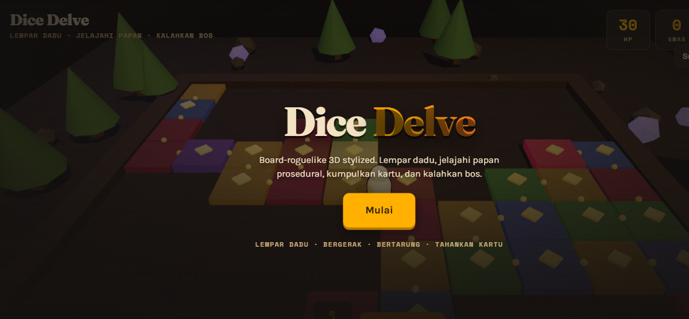
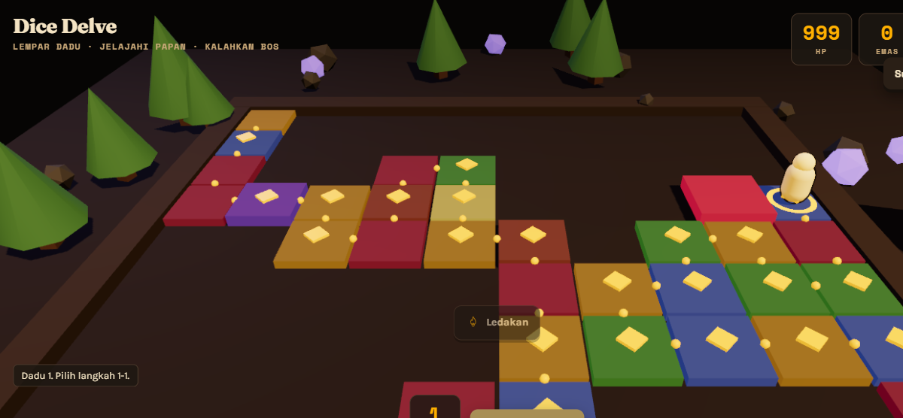
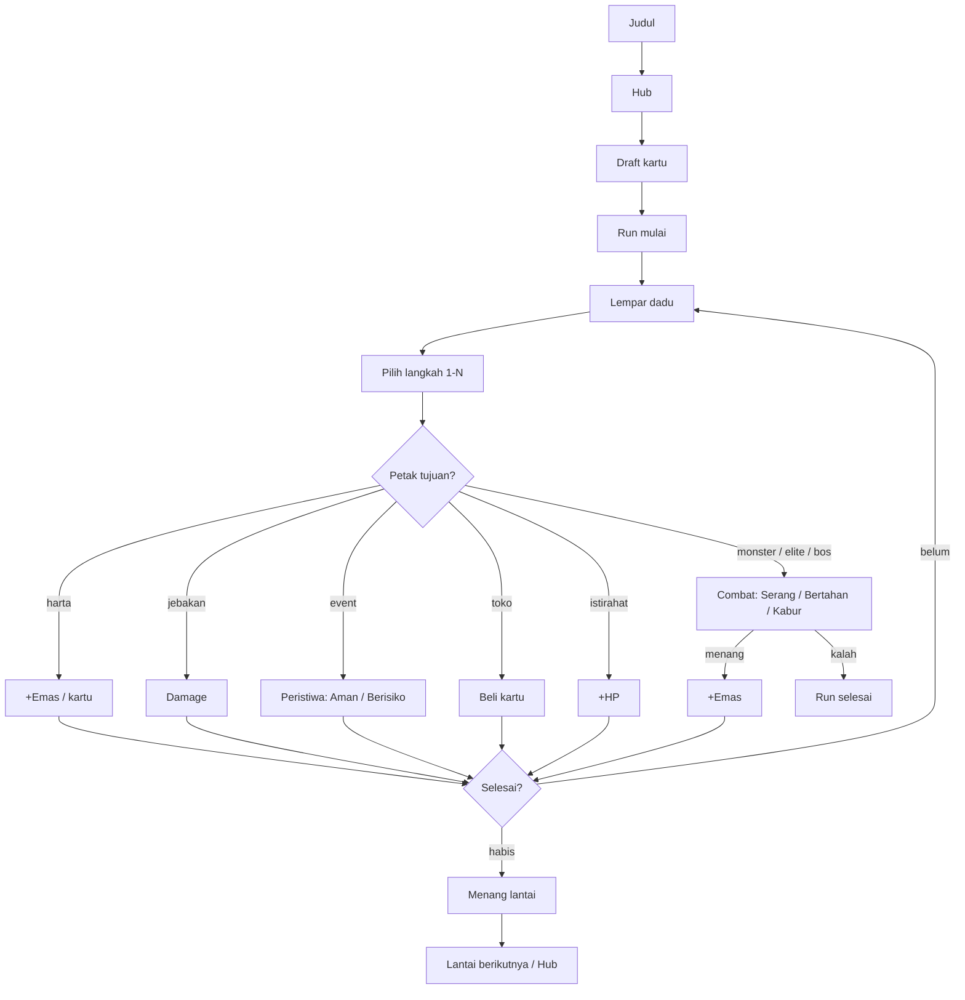

# Dice Delve

Board-roguelike 3D di browser: lempar dadu, **pilih** langkahmu, kumpulkan kartu,
hadapi AI berkepribadian, dan tembus 3 papan berbeda. Papan diacak ulang setiap
run (seed harian, bisa dibagikan), combat turn-based melawan monster yang bisa
dibaca niatnya, sistem kartu relic dengan skill aktif, hub meta-progresi, dan
PWA offline.

Demo: https://fawwaz1st.github.io/dice-delve/

## Cara main

Aturan singkat:

1. Di hub, beli upgrade permanen dengan shard.
2. Pilih 1 kartu awal dari draft (3 pilihan).
3. Klik Lempar Dadu, lalu **pilih** petak tujuan (1–nilai dadu).
4. Petak monster memulai combat: Serang, Bertahan, atau Kabur.
5. Skill aktif kartu bisa dipakai (tombol skill, ada cooldown).
6. Petak event menguji pilihan: Aman (pasti) atau Berisiko (jackpot/kutuk).
7. Kalahkan bos untuk menembus papan dan naik lantai (papan berubah).
8. HP mencapai nol mengakhiri run; hasil run menjadi shard.

## Fitur

- **Pilihan langkah**: lempar dadu, petak tujuan disorot, kamu pilih sendiri.
- **3 papan berbeda** bergilir per lantai (Hutan/Gua/Gunung Berapi): panjang,
  bobot petak, dan dekor tematik berbeda.
- **Combat 3 pilihan** (Serang/Bertahan/Kabur) + HP bar + intent monster.
- **AI berkepribadian**: Agresif (Serangan Berat), Penjaga (Perisai), Licik
  (Mengelak); bos bertahap 3 fase, enrage <33% HP.
- **10 kartu relic** dengan skill aktif (Ledakan, Sapuan, Tatapan, Terjang).
- **Peristiwa risiko**: Aman (pasti) vs Berisiko (jackpot/kutuk/kartu).
- **Draft** 1 dari 3 kartu di awal run.
- **Hub meta-progresi**: shard + 4 upgrade + statistik.
- **Juice**: partikel, damage numbers, kamera follow/shake, slow-mo saat kritis,
  FOV kick, hit-stop.
- **Deko aktif**: kristal melayang, pohon berayun, ember, lampu, dadu mengikuti pion.
- **Musik adaptif** (tenang/normal/tegang) + SFX disintesis penuh.
- **PWA**: bisa dipasang dan dimainkan offline.
- **Render**: WebGPURenderer (Three.js) dengan fallback WebGL2 nyata.
- **Aksesibilitas**: label, aria-live, tooltip hover, reduced-motion.

## Menjalankan

Prasyarat: Node.js 20+ dan pnpm.

    pnpm install
    pnpm dev        # http://127.0.0.1:5173/dice-delve/
    pnpm build      # bundle ke dist/

## Struktur proyek

    .
    ├── index.html              # Entri Vite
    ├── public/
    │   ├── manifest.webmanifest
    │   ├── sw.js               # Service worker offline-first
    │   └── icons/
    ├── docs/                   # Tangkapan layar README
    ├── src/
    │   ├── main.ts             # Boot, layar, HUD, loop
    │   ├── core/
    │   │   ├── Renderer.ts     # WebGPURenderer + fallback WebGL2
    │   │   ├── Loop.ts         # Fixed timestep + interpolasi
    │   │   └── Platform.ts     # Deteksi perangkat
    │   ├── render/
    │   │   ├── Scene.ts        # Meja, cahaya, dekor tematik
    │   │   └── Materials.ts    # Palet, material, outline ink
    │   ├── gameplay/
    │   │   ├── Board.ts        # Papan prosedural (3 varian + tema)
    │   │   ├── Dice.ts         # Dadu (pip + ter-seed)
    │   │   ├── Piece.ts        # Pion (squash & stretch)
    │   │   ├── Cards.ts        # Katalog 10 kartu relic
    │   │   ├── Run.ts          # Aturan (state, combat, AI, fase)
    │   │   └── Game.ts         # Orkestrator turn-based + FX
    │   ├── meta/
    │   │   └── Meta.ts         # Shard, upgrade, statistik
    │   ├── fx/
    │   │   ├── Particles.ts    # Sistem partikel
    │   │   ├── DamageNumbers.ts
    │   │   └── CameraRig.ts    # Follow, shake, slow-mo, orbit
    │   ├── audio/
    │   │   └── AudioEngine.ts  # SFX + musik adaptif
    │   ├── ui/
    │   │   ├── styles.css      # HUD, layar, toast, panel
    │   │   └── icons.ts        # 20 ikon SVG line-style
    │   └── utils/
    │       └── tween.ts        # Easing + fallback timer
    ├── .github/workflows/
    │   └── deploy.yml          # Build + deploy GitHub Pages
    ├── package.json
    ├── tsconfig.json
    ├── vite.config.ts
    ├── LICENSE
    └── README.md

## Teknologi

- TypeScript 7 (strict) + Vite 8.
- Three.js r187: WebGPURenderer + TSL, fallback WebGL2.
- Web Audio API untuk seluruh suara.
- Service Worker + Web App Manifest untuk PWA.
- Google Fonts: Fraunces, Karla, Space Mono.

## Roadmap

- Duel async musiman (leaderboard)
- Tema papan tambahan
- Battle pass ringan
- Mode harian ber-seed dengan tantangan khusus

## Kontribusi

1. Fork repositori ini.
2. Buat branch baru: git checkout -b feat/nama-fitur.
3. Commit: git commit -m 'feat: menambahkan fitur X'.
4. Push dan buka Pull Request.

Buka Issue untuk melaporkan bug atau mengusulkan fitur.

## Lisensi

Dirilis di bawah MIT License. Lihat berkas LICENSE.
