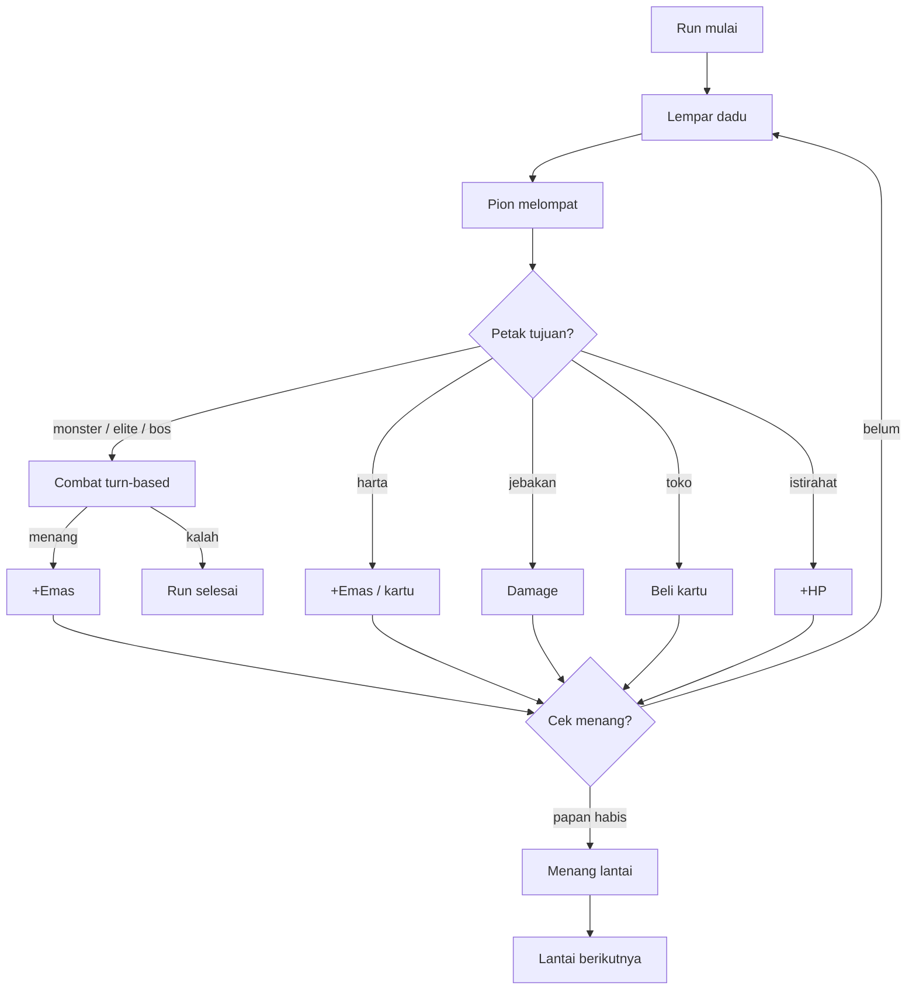

# Dice Delve

Board-roguelike 3D stylized yang berjalan langsung di browser: lempar dadu,
jelajahi papan prosedural, kumpulkan kartu, dan kalahkan bos. Papan 10x10
diacak ulang setiap run, lawan AI, sistem kartu relic, dan bisa dipasang
sebagai PWA (offline).

Demo: https://fawwaz1st.github.io/dice-delve/

## Cara main

Aturan singkat:

1. Klik Lempar Dadu (atau tekan tombol di layar) saat giliranmu.
2. Pion melompat sejumlah langkah sesuai nilai dadu.
3. Petak monster memulai combat turn-based melawan AI.
4. Kartu relic memperkuat dadu dan memberi efek di setiap giliran.
5. Kalahkan bos untuk menembus papan dan masuk lantai berikutnya.
6. HP mencapai nol mengakhiri run.

## Fitur

- Papan prosedural 10x10 dengan 34 petak — monster, elite, harta, jebakan,
  toko, istirahat, dan bos — seed harian (xorshift) sehingga papan bisa
  dibagikan dan diulang.
- Dadu 3D dengan animasi tween deterministik yang mendarat tepat pada
  nilai yang terpilih.
- Combat turn-based melawan AI dengan HP, serangan, dan pertahanan; elite
  dan bos yang lebih tangguh di lantai yang lebih dalam.
- 6 kartu relic (Bara Api, Batu Karat, Semanggi, Bulu Angin, Mata Ketiga,
  Pijar) dengan efek damage, regenerasi, dodge, dan dadu minimum.
- Toko untuk membeli kartu dengan emas, petak harta untuk emas dan kartu,
  jebakan yang memberi damage, istirahat yang memulihkan HP.
- Progresi lantai: papan baru tiap lantai, HP/emas/kartu dipertahankan.
- Audio disintesis penuh (Web Audio): SFX lempar, lompat, tabrakan, koin,
  kartu, menang, kalah, plus musik pentatonik adaptif. Tombol bisu di HUD.
- PWA: bisa dipasang ke layar utama dan dimainkan offline.
- WebGPURenderer (Three.js) dengan fallback WebGL2 otomatis.
- Loop fixed-timestep dengan interpolasi; deteksi tier perangkat dan
  pixel ratio clamp untuk 60fps di laptop menengah dan ponsel.
- Responsif: HUD adaptif, toast, log combat, layar akhir (menang/kalah),
  dan dukungan reduced-motion.

## Menjalankan

Prasyarat: Node.js 20+ dan pnpm.

    pnpm install
    pnpm dev        # http://127.0.0.1:5173/dice-delve/
    pnpm build      # bundle ke dist/

Deployment ke GitHub Pages ditangani GitHub Actions (push ke main).

## Struktur proyek

    .
    ├── index.html              # Entri Vite
    ├── public/
    │   ├── manifest.webmanifest
    │   ├── sw.js               # Service worker offline-first
    │   └── icons/
    ├── docs/                   # Tangkapan layar untuk README
    ├── src/
    │   ├── main.ts             # Orkestrasi boot, HUD, loop
    │   ├── core/
    │   │   ├── Renderer.ts     # WebGPURenderer + fallback WebGL2
    │   │   ├── Loop.ts         # Fixed timestep + interpolasi
    │   │   ├── Platform.ts     # Deteksi tier perangkat
    │   │   └── EventBus.ts
    │   ├── render/
    │   │   ├── Scene.ts        # Meja, papan, cahaya, kamera
    │   │   └── Materials.ts    # Palet, material, outline ink
    │   ├── gameplay/
    │   │   ├── Board.ts        # Papan prosedural (DFS backtracking)
    │   │   ├── Dice.ts         # Dadu animasi tween
    │   │   ├── Piece.ts        # Pion dengan squash & stretch
    │   │   ├── Cards.ts        # Katalog kartu relic
    │   │   ├── Run.ts          # Mesin aturan (state, giliran, combat)
    │   │   └── Game.ts         # Orkestrator turn-based
    │   ├── audio/
    │   │   └── AudioEngine.ts  # SFX + musik disintesis Web Audio
    │   ├── ui/
    │   │   └── styles.css      # HUD, toast, panel akhir
    │   └── utils/
    │       └── tween.ts        # Sistem tween (easing, fallback timer)
    ├── .github/workflows/
    │   └── deploy.yml          # Build + deploy GitHub Pages
    ├── package.json
    ├── tsconfig.json
    ├── vite.config.ts
    ├── LICENSE
    └── README.md

## Teknologi

- TypeScript 7 (strict) + Vite 8.
- Three.js r187: WebGPURenderer + TSL, fallback WebGL2.
- Web Audio API untuk seluruh suara (tanpa berkas).
- Service Worker + Web App Manifest untuk PWA.
- Google Fonts: Fraunces, Karla, Space Mono.

## Roadmap

- Hub meta-progresi dan upgrade permanen
- Draft kartu di awal run
- Duel async antar pemain (leaderboard musiman)
- Tema papan dan kosmetik pion
- Battle pass ringan

## Kontribusi

1. Fork repositori ini.
2. Buat branch baru: git checkout -b feat/nama-fitur.
3. Commit: git commit -m 'feat: menambahkan fitur X'.
4. Push dan buka Pull Request.

Buka Issue untuk melaporkan bug atau mengusulkan fitur.

## Lisensi

Dirilis di bawah MIT License. Lihat berkas LICENSE.
